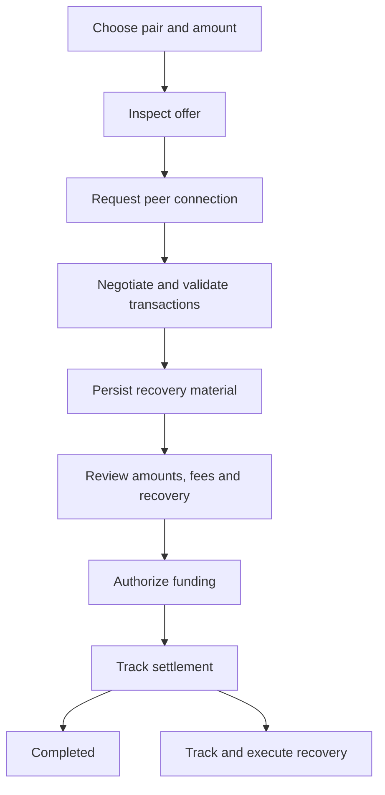

# Peer-to-peer swap interaction design

> Status: draft · Updated 2026-10-10 · Applies to: Smirk extension and desktop clients

This document owns the proposed P2P interaction and recovery contract. The
[protocol implementation](swap-core.md) currently provides an offline message
prototype. No P2P wallet flow, relay adapter or settlement capability is enabled.
The initial design focuses on taking existing offers. Publishing and managing
maker offers requires a separate availability, reservation and cancellation flow.

## Entry and discovery

Present one **Peer-to-peer** choice inside Swap. Messaging transports belong in
connection settings and technical details. The existing separate native-swap
and Nostr-orderbook placeholders should become this single entry when the UI is
implemented. Remove their unqualified pair, release and Sybil-resistance claims.
Preserve provider-backed swap flows and their separate settlement models.

Opening Swap must not initiate new relay connections. Offer discovery begins
with a deliberate action using configured, disclosed relays. Do not silently
fall back to other public relays. Explain that relays observe connection and
event metadata; public offers are not private discovery. Use dedicated swap
identities, independently of spending keys and the selected social identity.

The initial screen selects the assets and amount, then lists eligible offers.
Show only qualified combinations of protocol revision, pair, funding role,
network and platform. An authenticated advertisement does not prove reserved
inventory, maker availability or safe funding terms. Unknown, stale or
unreachable discovery must remain distinct from a reachable book with no offers.

| Offer field | Presentation |
| --- | --- |
| Amounts | Exact spend and receive amounts in native units; USD is an optional estimate |
| Fees | Identify network fees, fee assets and available fee bounds; unknown fees cannot appear as zero |
| Size | Indicate the accepted size; the current request constructor supports full advertised amounts only |
| Freshness | Show expiry and last observation without implying fresh maker consent |
| Availability | Distinguish an observed offer from an authenticated, responding peer |

Do not label a row executable or best-priced until its terms and fee basis are
comparable and currently validated. Offer selection reserves no funds. A changed
price, amount, fee ceiling or recovery policy requires a new review. A failed
P2P request must not silently select a provider-backed swap or another maker.

## Review and authorization

A relay receipt means **Relayed**. An authenticated route ACK means **Peer
connected**. Neither accepts terms or authorizes funding. The client must
validate the complete protocol transaction graph and recovery material before
presenting an actionable funding review. Commercial offer direction does not
determine funding order; that is an explicit protocol role.

The review must show the following facts together, with technical identifiers
available in details:

- Exact assets, networks, amounts and destination ownership.
- Network fee estimates and authorized ceilings, including recovery fees.
- Funds that will become locked, settlement conditions and required monitoring.
- Each available failure path: original-asset refund, compensation in another
  asset, any cooperation requirement and the applicable response deadlines.
- Recovery backup readiness and the availability requirements of this platform.

Approval binds an immutable terms revision and transaction plan. Revalidate
expiry, peer state, chain observations and unlock authority at execution. A
stale screen, duplicate click or late ACK cannot create a second funding action.
Respect existing per-operation password settings. Lock revokes unapproved
signing authority; it does not reverse a transaction already broadcast.

## Progress and recovery

Every attempt has a persistent details page reachable from Swap and Home
activity. Inbox notifications link to that page; neither Inbox nor an open swap
wizard owns protocol state. Keep active and unresolved swaps visible when
users hide an asset, disable discovery or a capability is withdrawn.

| State and evidence | Primary action and copy |
| --- | --- |
| Request prepared or relayed; no funds committed | **Cancel request**; stopping locally does not promise remote deletion |
| Peer connected; transaction plan incomplete | **Preparing swap**; no funding action available |
| Validated terms and durable recovery material | **Review swap**, then explicit funding approval |
| Funding submission uncertain | **Checking transaction status**; reconcile the exact transaction before any replacement |
| Funding observed, insufficient confirmations | **Waiting for confirmations**; show actual confirmations and required threshold |
| Funds locked, settlement in progress | **View progress**; identify the next protocol action and deadline |
| Recovery not yet eligible | **Waiting for recovery**; show the chain condition and estimated time separately |
| Recovery eligible and validated | **Recover funds**, or show previously authorized recovery submission |
| Recovery broadcast | **Recovery submitted**; completion requires the protocol's confirmation evidence |
| Original asset recovered | **Refunded** with the received amount and fees |
| Alternate asset received under the failure path | **Compensation received** with its asset and amount |
| Terminal settlement verified | **Completed** with receipts from both sides |
| Chain or peer evidence unavailable | **Status needs checking**; retain known locked funds and block unsafe additional actions |

**Close view** changes navigation only. After funding, do not offer a generic
**Cancel swap** action or erase state through the provider wizard's cancellation
API. Claim/refund races require protocol validation; reaching a timeout alone
does not prove that recovery succeeded. If all available paths fail, preserve
the record and evidence for diagnosis without presenting a successful refund.

Distinguish offer/request expiry from on-chain recovery deadlines. Display
heights or other actual eligibility conditions alongside explicitly estimated
times. Notifications help users act but are not the recovery mechanism. Avoid
fixed completion-time promises or assurances that atomicity eliminates fees,
capital lockup or monitoring obligations.

## Durable state and platform availability

The settlement engine owns transitions; the UI renders typed snapshots and
submits commands carrying the expected revision. An encrypted transactional
store must commit session state, replay identifiers, exact outbound bytes and
consumed signing nonces before publication or signing responses. Persist validated
recovery material before funding. Storage failure blocks irreversible work.
Retries reuse the recorded message or transaction; they do not extend consent
or recreate multiparty nonces. Use one session writer with conflict detection
across tabs, windows and restarts.

The existing extension send journal intentionally allows receipt writes to fail
without blocking an ordinary send. It cannot be the P2P recovery authority.
An ordinary wallet seed does not reconstruct every swap transcript, presigned
transaction or route key. Define and test an encrypted recovery export and
restoration procedure before funding is available. Diagnostic exports exclude
private keys, secrets, plaintext transcripts and spendable recovery material.

Browser popup closure, extension worker suspension, browser exit and desktop
process exit are different availability events. Qualify monitoring and recovery
for each supported platform. Do not promise that users can close the browser or
remain offline until an implemented recovery arrangement proves that behavior.
A relay cannot recover funds merely by observing a deadline. Broadcasting a
presigned recovery transaction while locked requires explicit, bounded prior
authorization and durable material; it grants no general signing authority.
Restoration must prevent duplicate signing and concurrent use of old backups.

## Integration boundaries

| Existing owner | Required integration |
| --- | --- |
| `packages/ui/src/components/SwapTab.tsx` | One P2P entry, offer selection, persistent progress and recovery views; keep provider deposit flows separate |
| `packages/extension/src/popup/routes/swap.tsx` | Typed commands to the persistent engine; do not keep settlement state only in component memory |
| `packages/core/src/payments/nostr-channel-io.ts` | Existing gift-wrap transport is a different protocol; introduce an explicit BasicSwap adapter |
| `crates/swap-core` | Validated terms, protocol transitions, immutable prepared messages and pair-specific recovery evidence |
| Platform runtime and encrypted store | Session ownership, outbox persistence, restart reconciliation and qualified monitoring |

`PreparedEnvelope` proves only that offline message preparation succeeded. It
provides no durability, relay delivery, peer consent or funding authority.
`OfferBook` and route objects are currently in memory. No existing type should
be promoted to an executable quote or funded session by a UI cast.

## Qualification checklist

- [ ] Review the offer, funding and recovery screens at extension and desktop widths.
- [ ] Verify keyboard navigation, screen-reader status updates, balance masking and themes.
- [ ] Map every visible state and action to protocol evidence and a tested transition.
- [ ] Test cancelled requests, late ACKs, stale offers, changed terms and duplicate clicks.
- [ ] Verify persistence failures, lost/duplicated messages, conflicting tabs and restored backups.
- [ ] Verify restart and suspension behavior with funds locked, including uncertain broadcasts.
- [ ] Complete both participant roles against the pinned peer implementation.
- [ ] Verify success, refund and compensation under fee pressure, reorganization and missed messages.
- [ ] Qualify each pair, protocol revision and platform before explicit activation.
- [ ] Retain recovery access when discovery or new-swap capability is disabled.

An unqualified pair remains disabled. Passing message compatibility tests alone
does not satisfy settlement or UI activation requirements.
